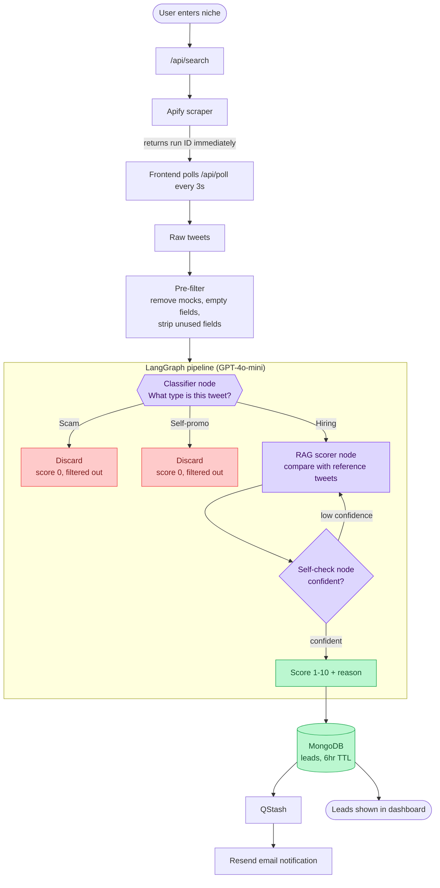

# X-Radar Architecture

## What it does
AI-powered Twitter/X lead generation SaaS for freelancers.
Users enter a niche and get scored, ranked leads from Twitter.

## Tech Stack
| Layer | Tech |
|---|---|
| Frontend | Next.js, TypeScript, Tailwind, Framer Motion |
| Backend | Next.js API routes, Node.js |
| Database | MongoDB + Mongoose (6hr TTL on leads) |
| AI orchestration | LangGraph |
| LLM | GPT-4o-mini |
| Retrieval | RAG over a reference-tweet store (known good hiring tweets) |
| Scraper | Apify |
| Queue | QStash |
| Email | Resend |
| Payments | DodoPayments |
| Deploy | Vercel |

## System Flow

## Core Flow
1. User enters a niche, which triggers `/api/search`.
2. Apify scrapes tweets and returns a run ID immediately (fire-and-poll).
3. Frontend polls `/api/poll` every 3s using the run ID.
4. Raw tweets are filtered (remove mocks, empty fields, strip unused fields).
5. Filtered tweets go into the LangGraph pipeline:
   - **Classifier node** labels each tweet as `hiring`, `scam`, or `self-promo`.
   - Scam and self-promo tweets are discarded (score 0, filtered out).
   - Hiring tweets go to the **RAG scorer node**, which compares them against reference tweets and scores 1-10.
   - **Self-check node** checks the model's confidence and loops back to re-score if it is low.
6. Final leads (score + reason) are stored in MongoDB with a 6hr TTL.
7. QStash triggers an email notification via Resend.

## Free vs Pro
| Plan | Tweet window |
|---|---|
| Free | 7 days ago to 2 days ago |
| Pro | `within_time:24h` (latest tweets) |
